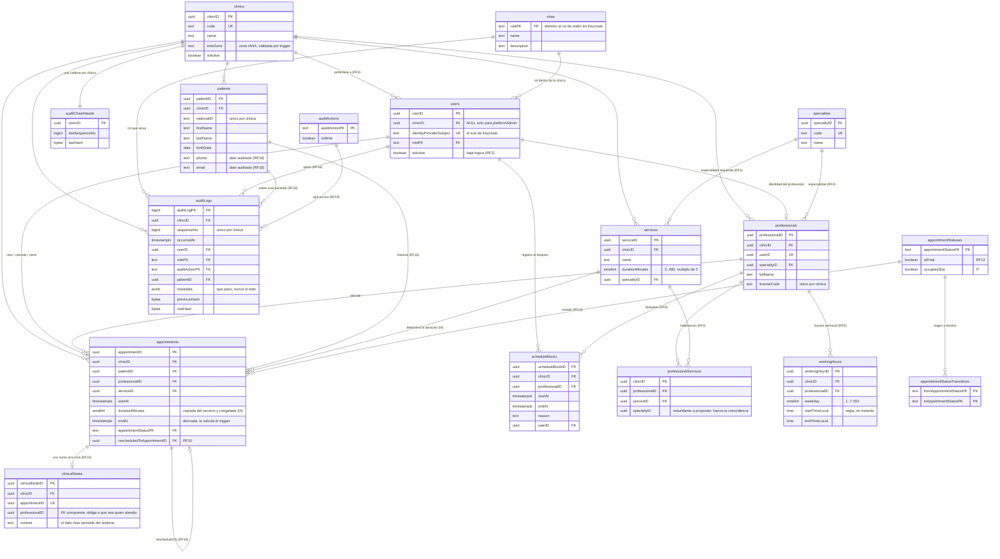

# Modelo de datos

El esquema vive en `db/schema/`, donde el prefijo numérico es el orden de aplicación.
Son 17 tablas repartidas en tres grupos que no se mezclan:

| Grupo | Tablas | Propiedad |
|---|---|---|
| Catálogos globales | `roles`, `specialties`, `appointmentStatuses`, `appointmentStatusTransitions`, `auditActions` | No llevan `clinicID`: son los mismos para todas las clínicas |
| Núcleo de negocio | `clinics`, `users`, `professionals`, `services`, `professionalServices`, `patients`, `workingHours`, `scheduleBlocks`, `appointments`, `clinicalNotes` | Toda fila pertenece a exactamente una clínica |
| Auditoría | `auditLogs`, `auditChainHeads` | De *tenant*, pero con reglas propias: solo admiten inserción |

## 1. Diagrama entidad-relación




## 2. Decisiones 

### La máquina de estados de RF13 es dato, no código

`appointmentStatusTransitions` declara en filas qué transiciones existen, y el trigger `appointmentsBu20ValidateStatusTransition` la consulta en lugar de conocerla.

- Cambiar el ciclo de vida de la cita es un `INSERT` o un `DELETE`
- Los cuatro estados finales no admiten salida se expresa por ausencia de filas, no con
  una bandera: lo que no está declarado, no se puede.
- Al ser un trigger del motor, la transición se rechaza aunque la escritura no pase por la API,
  que es lo que la defensa pregunta de los invariantes.

### Reprogramar (RF10) no mueve la fila

La cita original pasa a `rescheduled` (estado final) y apunta a su sustituta vía
`rescheduledToAppointmentID`. Los triggers rechazan mover `startAt`, `patientID`,
`professionalID` o `serviceID` de una cita existente (`MC004`).

Se eligió así porque el historial del paciente (RF16) debe poder reconstruir la cadena completa
de reprogramaciones, y porque una cita es un hecho que se agendó, no deja de
haber ocurrido porque luego se moviera. `UNIQUE ("rescheduledToAppointmentID")` garantiza que
una cita sustituye a lo sumo a una,.

### `users` no guarda correo, ni nombre, ni hash de contraseña

Solo `identityProviderSubject`, `clinicID` y `rolePK`. Keycloak es autoridad sobre quien;
PostgreSQL sobre **a qué clínica y con qué rol**. El costo asumido: la bitácora de RF19 muestra
uuid, y la API tendría que resolver el nombre contra el proveedor si hiciera falta. Se acepta
porque minimiza el dato personal almacenado y porque deja una sola autoridad sobre la identidad.

`roles."rolePK"` es exactamente el nombre del rol de realm en Keycloak, para que la
traducción token → dominio sea directa y verificable.

### El horario es una regla; la cita, un hecho

`workingHours` usa `time` + día de semana ISO. `appointments` usa `timestamptz`. Convertir entre
ambos exige la `timeZone` de la clínica, y esa conversión se hace en SQL

Guardar el horario como instante sería un error de modelado: «los lunes de 8 a 12» no es un instante, y ante un cambio de horario de verano el instante correcto cambia mientras la regla no.

### La autoría de la nota clínica es estructural, no comprobada

`clinicalNotes` no guarda quién la escribió como dato suelto: su clave ajena es compuesta contra la cita.

```sql
FOREIGN KEY ("clinicID", "appointmentID", "professionalID")
    REFERENCES "appointments" ("clinicID", "appointmentID", "professionalID")
```

De modo que el `professionalID` de la nota solo puede ser el del profesional que figura en esa
cita.

### Los catálogos no llevan `clinicID`

Una especialidad médica no es propiedad de una clínica, y hacer los catálogos de tenant obligaría a sembrarlos tres veces e impediría comparar entre clínicas en la Etapa 2. El costo: una clínica no puede inventar su propia especialidad sin que la plataforma la añada. 

## 5. Datos semilla

`db/seed/01_seed.sql`, aplicado por `initdb.sh` cuando el volumen está vacío. 

| Contenido | Cantidad |
|---|---|
| Clínicas | 3: `santa-lucia`, `monteverde`, `guanacaste`, todas en `America/Costa_Rica` |
| Usuarios | 1 de plataforma + 4 por clínica (administrador, recepción y dos profesionales) |
| Profesionales | 2 por clínica, con especialidades distintas entre sí |
| Servicios, horarios, bloqueos, pacientes, citas, notas y bitácora | repartidos por las tres clínicas |
